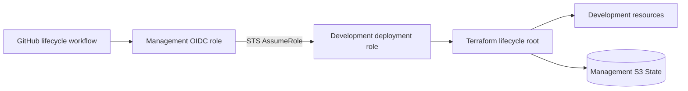
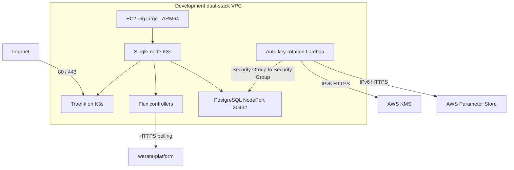

<div align="center">

# WERANT

### Infrastructure Engineering

**Secure. Modular. Automated.**

Infrastructure as Code powering the Werant ecosystem.

<br />

[](https://developer.hashicorp.com/terraform)
[](https://aws.amazon.com/)
[](https://github.com/features/actions)

<br />


</div>

---

## Overview

Werant Infrastructure provisions the AWS foundation used by the Werant Development environment. The repository separates resources by operational lifecycle so that Network, Security, Storage, Compute, and Messaging have independent state, permissions, and deployment workflows.

The current implementation provides:

- centralized and encrypted Terraform State in the Management account;
- GitHub OIDC federation without long-lived AWS credentials;
- cross-account deployment roles with lifecycle-specific least privilege;
- a dual-stack Development network;
- customer-managed KMS keys and encrypted S3 building blocks;
- an ARM64 EC2 node bootstrapped with K3s and Flux;
- a private key-rotation Lambda and its runtime identities;
- EC2 operating-hour schedules and disabled key-rotation schedules;
- validation plus controlled `plan` and `apply` workflows.

> [!NOTE]
> Development is implemented first. Homologation and Production remain future environment expansions.

## Architecture

### AWS accounts

| Account | ID | Responsibility |
| :-- | :-- | :-- |
| Management | `633697459676` | Terraform State, GitHub OIDC federation, and centralized governance |
| Development | `904054820030` | Development workloads, runtime identities, and lifecycle deployment roles |

### Provisioning flow



Authentication and authorization are intentionally separate:

1. GitHub obtains an OIDC token for the `development` environment.
2. The token assumes the lifecycle's federated role in Management.
3. That role can assume only the matching deployment role in Development.
4. Terraform uses the Development role to manage resources and its own State object.

### Development lifecycles

| Lifecycle | Owned resources |
| :-- | :-- |
| Network | VPC, IPv4/IPv6 subnet, Internet Gateway, egress-only IPv6 gateway, routes, and Security Groups |
| Security | Auth envelope-encryption KMS key and application-storage KMS key |
| Storage | KMS-encrypted, versioned, private S3 buckets supplied through the `buckets` input |
| Compute | ARM64 EC2 node, K3s/Flux bootstrap, EC2 schedules, Lambda, CloudWatch log group, and Lambda alias |
| Messaging | EventBridge Scheduler group and Auth key-rotation schedules |

The root modules discover their live AWS dependencies through known names and mandatory tags. They do not read or mutate another lifecycle's Terraform State.

### Runtime topology



The EC2 node uses a 30 GiB encrypted GP3 root volume and a public IPv4 address. Only HTTP and HTTPS ingress are public. PostgreSQL port `30432` is authorized exclusively from the Lambda Security Group and is never exposed to the internet.

Flux watches `LeonardoNXT/werant-platform`, branch `main`, path `./clusters/development`. Application and data workloads belong to that GitOps repository rather than to Terraform.

## Repository structure

```text
.
├── .github
│   ├── actions
│   │   └── terraform-lifecycle
│   │       └── action.yml
│   └── workflows
│       ├── terraform-validate.yml
│       ├── terraform-network.yml
│       ├── terraform-security.yml
│       ├── terraform-storage.yml
│       ├── terraform-compute.yml
│       └── terraform-messaging.yml
└── terraform
    ├── bootstrap
    │   ├── state
    │   └── identity
    │       ├── federation
    │       └── development
    ├── environments
    │   └── development
    │       ├── network
    │       ├── security
    │       ├── storage
    │       ├── compute
    │       └── messaging
    └── modules
        ├── deployment-policy
        ├── deployment-roles
        ├── ec2-instance
        ├── eventbridge-scheduler
        ├── github-oidc-policy
        ├── github-oidc-provider
        ├── github-roles
        ├── kms-key
        ├── lambda-function
        ├── public-routing
        ├── s3-bucket
        ├── security-group
        ├── service-roles
        ├── subnet-instance
        ├── terraform-apply-policy
        └── vpc-instance
```

Bootstrap is deliberately excluded from GitHub deployment workflows. It is an administrative foundation and must be operated locally through an authorized AWS Identity Center session.

## Terraform State

State is stored in `werant-tfstate-633697459676` in the Management account.

```text
werant-tfstate-633697459676
├── bootstrap/terraform.tfstate
├── bootstrap/identity/federation/terraform.tfstate
├── bootstrap/identity/development/terraform.tfstate
└── development
    ├── network/terraform.tfstate
    ├── security/terraform.tfstate
    ├── storage/terraform.tfstate
    ├── compute/terraform.tfstate
    └── messaging/terraform.tfstate
```

State protections include:

- public-access blocking and bucket-owner-enforced ownership;
- versioning and S3 native lockfiles;
- customer-managed KMS encryption with bucket keys;
- bucket-policy denial of non-TLS traffic;
- denial of uploads with an unexpected encryption algorithm or KMS key;
- `prevent_destroy` on the State bucket and KMS key;
- lifecycle roles restricted to their own State object and lockfile.

## Identity and access

Every lifecycle owns two identities:

- a federated role in Management, assumed through GitHub OIDC;
- a deployment role in Development, assumed from that federated role.

The OIDC trust policy validates:

| Claim | Constraint |
| :-- | :-- |
| `aud` | `sts.amazonaws.com` |
| `sub` | Immutable owner/repository IDs and the `development` environment |
| `repository_owner_id` | LeonardoNXT's immutable owner ID |
| `repository_id` | `werant-infrastructure` immutable repository ID |
| `environment` | `development` |
| `ref` | `refs/heads/main` |
| `job_workflow_ref` | Exact lifecycle workflow file on `main` |

Consequently, a Network workflow cannot assume the Compute role, and another workflow in the same repository cannot reuse a lifecycle's federated identity.

The independent `werant-key-rotation` repository has its own OIDC role and can update function code, publish a version, and promote the `live` alias. It cannot invoke the Lambda, modify its configuration, or pass runtime roles.

## CI/CD

### Continuous validation

`terraform-validate.yml` runs on relevant pull requests and pushes to `main`:

- `terraform fmt -check -recursive -diff`;
- `terraform init -backend=false`;
- `terraform validate` for every implemented root and child module.

Validation never authenticates to AWS and never changes infrastructure.

### Lifecycle deployments

| Workflow | Root module | Management OIDC role | Development deployment role |
| :-- | :-- | :-- | :-- |
| `terraform-network.yml` | `development/network` | `network-github-oidc-role-dev` | `network-terraform-deploy-role` |
| `terraform-security.yml` | `development/security` | `security-github-oidc-role-dev` | `security-terraform-deploy-role` |
| `terraform-storage.yml` | `development/storage` | `storage-github-oidc-role-dev` | `storage-terraform-deploy-role` |
| `terraform-compute.yml` | `development/compute` | `compute-github-oidc-role-dev` | `compute-terraform-deploy-role` |
| `terraform-messaging.yml` | `development/messaging` | `messaging-github-oidc-role-dev` | `messaging-terraform-deploy-role` |

Each workflow is started manually with `workflow_dispatch` on `main`. The `operation` input defaults to `plan` and permits `apply` only as an explicit choice.

The shared composite action performs:

1. operation validation;
2. Terraform setup;
3. formatting check;
4. backend initialization;
5. configuration validation;
6. plan creation as `tfplan`;
7. application of that exact plan when `operation=apply`.

Plans are not uploaded as artifacts because they can contain sensitive values and can become stale. `apply` creates and consumes its plan in the same serialized job.

The composite action does not authenticate or select roles. Authentication remains visible and independently restrictable in each lifecycle workflow.

### GitHub environment

The repository must have an environment named `development`. Configure it with:

- deployment branch restricted to `main`;
- required reviewers when every Development lifecycle execution should be approved;
- no static AWS credentials.

Both `plan` and `apply` use temporary OIDC credentials. The workflow requests only `contents: read` and `id-token: write`.

## Deployment order

### Bootstrap — local administration

Bootstrap requires an authorized AWS Identity Center session and is never run by the lifecycle workflows.

1. Provision `terraform/bootstrap/state` initially with the backend disabled.
2. Migrate its local State into the newly created S3 backend.
3. Apply `terraform/bootstrap/identity/federation` in Management.
4. Apply `terraform/bootstrap/identity/development` in Development, supplying the State KMS key ARN.

Review every Bootstrap plan before applying it. The Identity roots create and modify the roles that authorize all subsequent automation.

### Development lifecycles

After Bootstrap, execute both `plan` and `apply` in this order:

1. Network
2. Security
3. Storage
4. Compute
5. Messaging

Storage depends on the Security KMS alias. Compute discovers Network and Identity resources. Messaging discovers the Lambda alias created by Compute.

## Operational notes

### EC2 operating hours

All schedules use `America/Sao_Paulo`:

| Period | Start | Stop |
| :-- | :-- | :-- |
| Monday through Friday | 18:00 | 00:00 |
| Saturday and Sunday | 14:00 | 23:00 |

### Auth key rotation

Terraform creates the Lambda from a failing placeholder package so the function can exist before the application repository performs its first code deployment. Terraform ignores subsequent function-code and alias-version changes because those fields belong to `werant-key-rotation` CI/CD.

The rotation schedules are defined but intentionally `DISABLED`:

- weekdays: every 10 minutes from 18:00 through 23:50;
- weekends: every 10 minutes from 14:00 through 22:50.

Enable them only after all of the following are true:

- the real ARM64 `bootstrap` ZIP is deployed and the `live` alias is promoted;
- `/werant/development/auth/postgres` exists as an SSM `SecureString`;
- PostgreSQL is healthy inside K3s and privately reachable on NodePort `30432`;
- a manual Lambda invocation completes successfully.

The Parameter Store value is intentionally outside Terraform so plaintext database credentials never enter Terraform State.

### Storage buckets

The Storage root is reusable and defaults to an empty `buckets` map. Add workload buckets explicitly with globally unique `werant-dev-*` names and lifecycle rules. Every managed bucket is private, versioned, TLS-only, and encrypted with the application-storage KMS key.

## Local development

### Requirements

- Terraform CLI `>= 1.10.0`;
- AWS CLI v2 and AWS IAM Identity Center access for Bootstrap;
- Git;
- access to the Management and Development accounts appropriate to the operation.

### Formatting and validation

```bash
terraform fmt -check -recursive -diff
```

For a root module without initializing its remote backend:

```bash
terraform -chdir=terraform/environments/development/network init -backend=false
terraform -chdir=terraform/environments/development/network validate
```

Regular Development `apply` operations must use GitHub Actions. Local apply is reserved for the documented Bootstrap process.

## Implementation status

- [x] Centralized and protected Terraform State.
- [x] GitHub OIDC federation and cross-account role chaining.
- [x] Lifecycle-specific IAM roles and State permissions.
- [x] Network, Security, Storage, Compute, and Messaging roots.
- [x] Automated formatting and validation.
- [x] Controlled lifecycle `plan` and `apply` workflows.
- [ ] Execute and verify the first complete Development deployment.
- [ ] Enable Auth key-rotation schedules after runtime readiness checks.
- [ ] Expand the architecture to Homologation and Production.

## Engineering philosophy

Werant Infrastructure is designed around a simple principle:

**Complexity should be controlled through explicit boundaries, not hidden behind automation.**

Infrastructure components have clear ownership, predictable behavior, isolated State, and auditable execution. Automation removes repetitive operations without removing visibility or control.

---

<div align="center">

**WERANT / INFRASTRUCTURE**

_Built for reliability. Designed for scale._

<sub>Infrastructure as Code · Platform Engineering · Cloud Security</sub>

</div>
