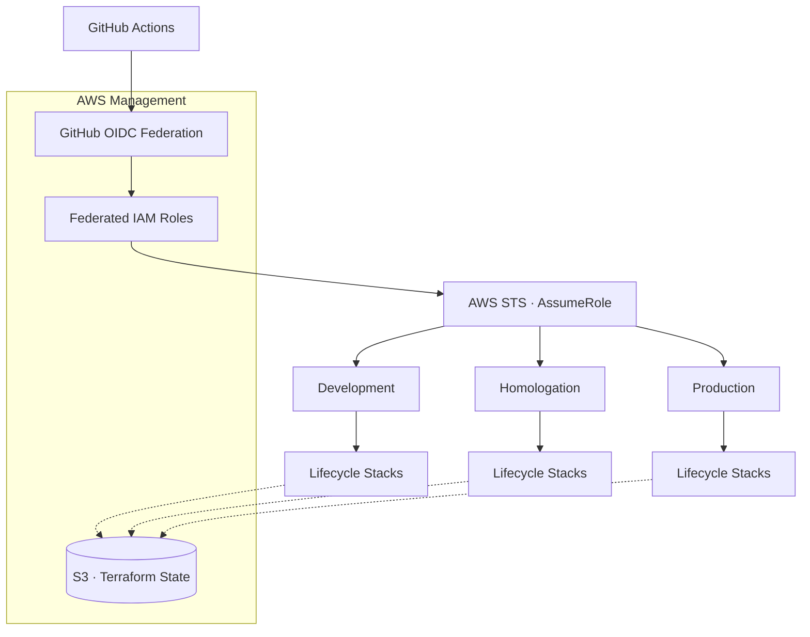
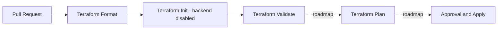

<div align="center">

# WERANT

### Infrastructure Engineering

**Secure. Modular. Automated.**

Infrastructure as Code powering the Werant ecosystem.

A multi-account AWS infrastructure built with Terraform, designed around isolated resource lifecycles, federated identities, and automated provisioning.

<br />

[](https://developer.hashicorp.com/terraform)
[](https://aws.amazon.com/)
[](https://github.com/features/actions)

<br />


</div>

---

## Overview

**Werant Infrastructure** is the infrastructure foundation of the Werant platform.

The project establishes a reproducible, security-oriented approach to provisioning and managing cloud resources across multiple AWS accounts.

Rather than treating infrastructure as a single deployment unit, Werant organizes resources by their operational lifecycle, allowing independent state management, isolated permissions, and controlled execution.

The architecture is guided by five principles:

- **Isolation by design** — Independent AWS accounts for development, homologation, and production.
- **Lifecycle ownership** — Infrastructure stacks manage resources with related operational lifecycles.
- **Least-privilege access** — Federated IAM roles with explicitly scoped permissions.
- **Reproducible infrastructure** — Declarative Terraform modules with consistent configurations.
- **Automated operations** — Infrastructure validation and provisioning through GitHub Actions.

> [!NOTE]
> The infrastructure is under active development. The architecture described below represents the intended platform design; individual capabilities are introduced incrementally.

---

## Architecture

Werant adopts a multi-account AWS architecture with centralized infrastructure governance and isolated workload execution.

### AWS Account Organization

| Account          | Responsibility                                                                      |
| :--------------- | :---------------------------------------------------------------------------------- |
| **Management**   | AWS Organizations, identity federation, centralized Terraform State, and governance |
| **Development**  | Development workloads and infrastructure validation                                 |
| **Homologation** | Pre-production testing and integration                                              |
| **Production**   | Production workloads and critical infrastructure                                    |

Each workload account maintains its own resources, IAM permissions, and deployment boundaries.

### Infrastructure Provisioning Flow



The provisioning model separates three responsibilities:

1. **Authentication** — GitHub Actions authenticates through AWS IAM OIDC federation.
2. **Authorization** — IAM roles determine which operations a workflow can execute.
3. **Provisioning** — Terraform manages resources according to the selected lifecycle.

Federated roles and cross-account execution roles are designed to enforce boundaries between environments and infrastructure capabilities.

---

## Repository Structure

```text
werant-infra/
│
├── .github/
│   └── workflows/
│       └── terraform-validate.yml
│
└── terraform/
    │
    ├── bootstrap/
    │   ├── state/
    │   └── identity/
    │       └── federation/
    │
    └── modules/
        ├── github-oidc-provider/
        ├── github-roles/
        ├── deployment-roles/
        └── terraform-apply-policy/
```

The tree illustrates the intended structure. Lifecycle directories and modules are added as their implementations become necessary.

### Directory Responsibilities

| Directory                | Purpose                                             |
| :----------------------- | :-------------------------------------------------- |
| `.github/workflows`      | Terraform formatting and validation workflow         |
| `terraform/bootstrap`    | Initial infrastructure and identity provisioning    |
| `terraform/modules`      | Reusable Terraform child modules                    |

Environment-specific root modules remain roadmap items and will be added when their corresponding infrastructure is implemented.

---

## Terraform Design

### Lifecycle-Based Infrastructure

Infrastructure is divided into independent lifecycle units.

Each lifecycle is represented by a Terraform root module, responsible for managing a related collection of AWS resources.

```text
development/
├── network/
│   └── terraform.tfstate
│
├── compute/
│   └── terraform.tfstate
│
└── database/
    └── terraform.tfstate
```

A lifecycle can include multiple resources, but its state remains independent from other lifecycles.

For example:

| Lifecycle | Resource scope                                   |
| :-------- | :----------------------------------------------- |
| Network   | VPC, subnets, routing, security groups           |
| Compute   | EC2, ECS, Lambda, compute-related resources      |
| Database  | Database instances and associated infrastructure |
| Storage   | Object storage and storage policies              |
| Identity  | IAM roles, policies, and federation              |

Resource ownership is defined by lifecycle boundaries rather than individual AWS services alone.

### Reusable Modules

Child modules encapsulate resource definitions, default configurations, and infrastructure conventions.

Root modules compose these abstractions into deployable infrastructure stacks.

```hcl
module "network" {
  source = "../../../modules/network"

  environment = "development"
  vpc_cidr    = "10.10.0.0/16"
}
```

This approach minimizes repeated Terraform configuration while preserving explicit infrastructure ownership.

---

## State Management

Terraform State is stored in a centralized Amazon S3 bucket owned by the AWS Management account.

Each lifecycle has an independent object key.

```text
S3 · werant-tfstate-<management-account-id>
│
├── bootstrap/
│   ├── terraform.tfstate
│   └── identity/
│       └── federation/
│           └── terraform.tfstate
│
├── development/
│   ├── network/
│   └── compute/
│
├── homologation/
│   ├── network/
│   └── compute/
│
└── production/
    ├── network/
    └── compute/
```

### Backend Configuration

```hcl
terraform {
  backend "s3" {
    bucket       = "werant-tfstate-<management-account-id>"
    key          = "development/network/terraform.tfstate"
    region       = "sa-east-1"

    encrypt      = true
    use_lockfile = true
  }
}
```

The backend provides:

- Centralized remote state storage.
- Independent state files per lifecycle.
- Native S3 state locking.
- Bucket versioning for state recovery.
- Server-side encryption with a customer-managed KMS key and bucket keys.
- HTTPS-only access enforced by bucket policy.
- Rejection of explicit encryption headers that attempt to bypass the state KMS key.
- Restricted cross-account access.

State permissions are designed to be scoped to the corresponding environment and lifecycle.

---

## Identity & Access Management

Werant uses AWS IAM and OpenID Connect to authenticate infrastructure workflows without relying on long-lived AWS access keys.

### GitHub OIDC Federation

A centralized OIDC identity provider establishes trust between GitHub Actions and AWS.

```text
GitHub Actions
      |
      | OIDC Token
      v
AWS IAM OIDC Provider
      |
      | AssumeRoleWithWebIdentity
      v
Federated IAM Role
      |
      | STS AssumeRole
      v
Environment Execution Role
      |
      v
Terraform Provisioning
```

The intended identity model provides:

- Centralized GitHub OIDC federation.
- Environment and lifecycle-specific execution permissions.
- Explicit cross-account IAM trust relationships.
- Temporary AWS credentials.
- Controlled workflow authorization.
- Separation between bootstrap and deployment privileges.

### Trust Boundaries

Federated trust policies are designed to validate GitHub OIDC claims such as:

| Claim              | Purpose                                                  |
| :----------------- | :------------------------------------------------------- |
| `aud`              | Validate the intended AWS STS audience                   |
| `sub`              | Restrict the authorized repository and execution context |
| `repository_id`    | Bind access to an immutable repository identity          |
| `ref`              | Restrict the Git reference                               |
| `repository_owner_id` | Bind access to an immutable repository owner identity |
| `environment`      | Restrict access to an approved GitHub environment         |

Claim conditions must be validated against actual GitHub-issued tokens and supported AWS IAM condition keys.

The current trust policy combines the immutable repository and owner IDs with the `main` ref and the `development` environment. GitHub environment protection rules must be configured before deployment workflows are enabled.

---

## Bootstrap

The bootstrap layer provisions the foundational resources required before regular infrastructure deployment can begin.

It is executed through a dedicated administrative identity.

### State Bootstrap

Responsible for provisioning and protecting the centralized Terraform backend.

- Amazon S3 bucket.
- Bucket versioning.
- Server-side encryption.
- Customer-managed KMS key with automatic rotation.
- Bucket policy enforcing TLS and the expected KMS key.
- Public access blocking.
- Object ownership configuration.
- Accidental deletion protection.

The initial bootstrap uses local Terraform State until the S3 backend becomes available.

### Identity Bootstrap

Responsible for establishing the identities required for automated infrastructure execution.

- GitHub OIDC identity provider.
- Federated IAM roles.
- Cross-account trust relationships.
- Lifecycle deployment permissions.

The identity bootstrap is separated from regular infrastructure deployments to avoid circular authorization dependencies.

---

## CI/CD Strategy

Terraform formatting and validation are performed through GitHub Actions. Automated plan and apply remain roadmap items.

The pipeline architecture is designed around independent root modules and controlled execution permissions.

### Deployment Lifecycle



### Execution Principles

**Change isolation**

Validation runs independently for each current root and child module. Deployment change detection will be introduced with environment root modules.

**Credential isolation**

Each execution assumes the IAM role authorized for its environment and lifecycle.

**Plan verification**

Infrastructure changes should be validated before applying them.

**Production protection**

Production deployments require additional authorization and approval controls.

**Traceability**

Infrastructure changes remain associated with version-controlled commits and workflow executions.

---

## Security Principles

Security is treated as an architectural requirement rather than a post-deployment feature.

| Control               | Strategy                               |
| :-------------------- | :------------------------------------- |
| Authentication        | GitHub OIDC federation                 |
| Authorization         | IAM least-privilege policies           |
| Environment isolation | Separate AWS accounts                  |
| State protection      | S3 encryption, versioning, and locking |
| Credential management | Temporary STS credentials              |
| Deployment validation | Terraform plan and policy evaluation   |
| Production governance | Protected deployment workflows         |
| Resource boundaries   | Lifecycle-based ownership              |

> [!IMPORTANT]
> Terraform root modules do not automatically establish IAM security boundaries. Permissions must be enforced through the execution roles, trust policies, and applicable AWS account controls.

---

## Development

### Requirements

- Terraform CLI
- AWS CLI v2
- AWS IAM Identity Center access
- Git
- Authorized AWS accounts and IAM roles

### Local Validation

Terraform configurations can be formatted and validated locally.

```bash
terraform fmt -recursive
```

For a specific root module:

```bash
cd terraform/bootstrap/identity/development

terraform init -backend=false
terraform validate
```

### Infrastructure Deployment

Regular environment deployments are managed through GitHub Actions rather than local `terraform apply` executions.

The bootstrap remains an explicitly controlled administrative operation.

---

## Roadmap

- [x] Define the multi-account infrastructure architecture.
- [x] Establish the Terraform repository structure.
- [x] Configure initial AWS Identity Center access.
- [ ] Complete centralized Terraform State bootstrap.
- [ ] Complete GitHub OIDC federation.
- [ ] Implement lifecycle-specific IAM roles.
- [ ] Establish cross-account state permissions.
- [ ] Implement automated Terraform plan and apply.
- [ ] Introduce infrastructure policy validation.
- [ ] Provision the initial Development infrastructure.
- [ ] Expand infrastructure to Homologation and Production.

---

## Engineering Philosophy

Werant Infrastructure is designed around a simple principle:

**Complexity should be controlled through explicit boundaries, not hidden behind automation.**

Infrastructure components should have clear ownership, predictable behavior, isolated state, and auditable execution.

Automation exists to eliminate repetitive operations without removing visibility or control over the systems being managed.

---

<div align="center">

**WERANT / INFRASTRUCTURE**

_Built for reliability. Designed for scale._

<sub>Infrastructure as Code · Platform Engineering · Cloud Security</sub>

</div>
